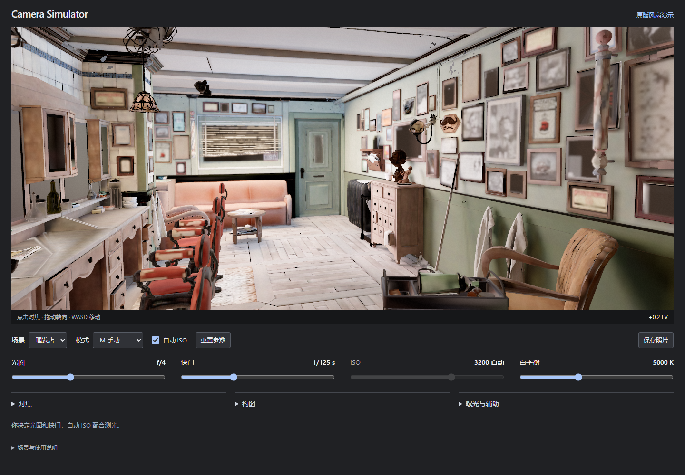
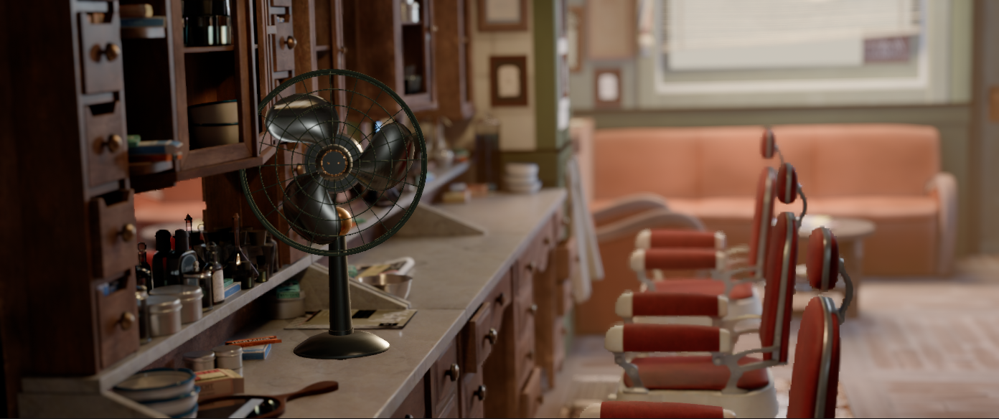

# Source lighting and mirror optics

The viewfinder and four primary sliders retain their existing interaction. All additional work operates within the rendering modules.

## Delivered behavior

- The full-geometry barbershop has source-material albedo, source roughness and a denoised static direct/indirect diffuse atlas. Matte source diffuse shaders retain a rough surface; their Oren–Nayar roughness is interpreted separately from PBR specular roughness. Directly textured source shaders keep their individual image resolution. The sofa retains its source material tint, and the cobweb image/ramp drives an alpha cutout.
- Continuous translation, rotation and focal length operate on the complete room geometry. Up to four 512px mirrors follow actual world planes, including geometry with baked node transforms. Reflected distance comes from the mirror camera's depth projection. Clicking and AF-C use the reflected object's virtual point; physical room depth still controls occlusion.
- All seven photographic barbershop views carry an additional 1280px source-derived optical-distance map. They add about 0.48MiB per selected view. Only the lens and focus use virtual distance. The live fan continues to occlude the source photograph at its physical depth.
- The full-geometry flash is mounted 8cm above the lens, follows camera direction, casts a 512px shadow map and preserves pulse energy across shutter times. The photographic background retains its existing isolated Cycles flash layers and recorded scene-local fill positions.
- The live fan uses neutral steel blades and a restrained painted metal finish with the source room's HDR and direct lights. Its tabletop reflection/shadow stay within the existing temporal integration region.

## Visual evidence

[Source Cycles reference](optics/cycles-reference.png) and [geometry at the matching source camera](optics/geometry-reference.png) show the remaining difference in glossy response, small surface detail and volumetric atmosphere. The source comparison uses the source camera's actual lens/sensor projection; the ordinary full-geometry starting view is closer to the room and has its own composition controls.

## Scope and continuation

The source-backed atlas is delivered for the barbershop. Classroom, kitchen and apartment use the existing optimized geometry, real-time lighting and photographic source packs. The bake tools support another scene through its source hash and delivered world-space triangles; each resulting scene still needs visual review before adoption.

The room reflection probe is captured once per load. Mirror views and direct flash update with the camera and moving objects. Baked indirect illumination stays static. Mirror depth represents one reflection bounce; glass refraction, repeated mirror bounces, local reflection probes, area-flash penumbrae and full indirect response to moving objects remain future rendering work. Large-aperture edges use the existing depth-aware screen-space gather.

The source scene has richer lighting and materials than the optimized raster conversion. The comparison images document this gap; the current full-geometry output is a usable intermediate improvement.

## Verification

Asset audits check source identity, delivered byte budgets, atlas dimensions, retained alpha cutouts and every optical-depth pixel. Reflected path length must reach the physical mirror first. Browser regressions verify independent material UV channels, both mirror transform conventions, virtual focus sharpness, reflected camera parallax, physical occlusion, flash energy, thin-edge blur and export scaling. Floating-point depth buffers are excluded from radiance measurements because their values represent metres.

Validation: all 38 production-browser tests passed on hardware Chrome, together with all 12 calculation tests, four scene asset budgets, 28 photographic positions and seven optical-depth sidecars. Eight affected browser regressions passed again after restricting the virtual-distance override to marked mirror pixels, including physical occlusion and preserved non-mirror focus. The pull request runs the production suite on software-rendered Chromium. `optics/review.json` records captured renderer state and an empty browser-error list.
